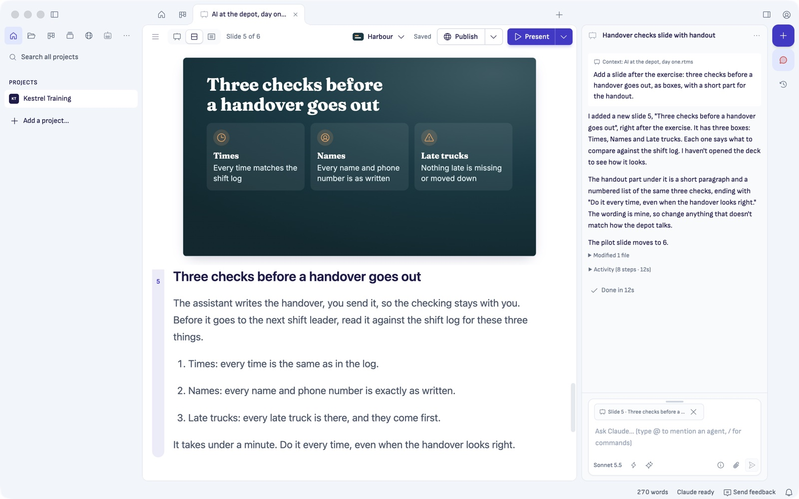
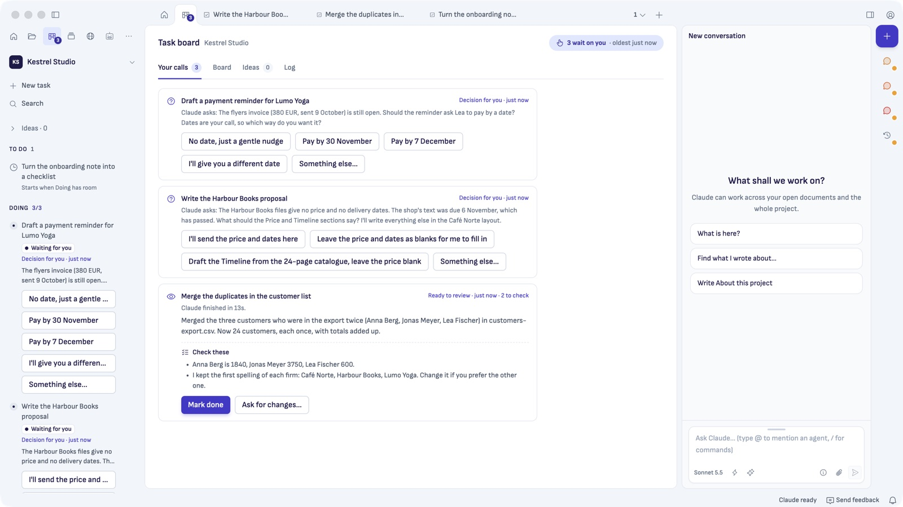
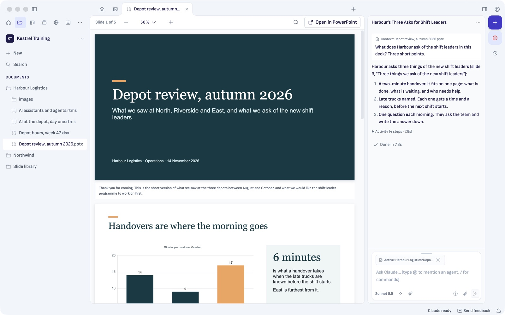

<p align="center">
  <a href="https://ritemark.app">
    <picture>
      <source media="(prefers-color-scheme: dark)" srcset="docs/assets/readme/ritemark-logo-on-dark.svg">
      
    </picture>
  </a>
</p>

<p align="center"><strong>Ritemark turns a folder on your computer into a workspace where ChatGPT or Claude work with you.</strong></p>

<p align="center">
  <a href="https://github.com/ProductoryHQ/ritemark-native/releases/latest"></a>
  
  <a href="LICENSE"></a>
</p>

<p align="center">
  <a href="https://ritemark.app">Website</a> ·
  <a href="#download">Download</a> ·
  <a href="docs/user/getting-started.md">Getting started</a> ·
  <a href="https://github.com/ProductoryHQ/ritemark-native/releases/latest">What's new</a>
</p>



## What Ritemark is

Your notes, transcripts, sources and drafts sit in one folder. In Ritemark, ChatGPT or Claude work in that folder with you. The AI starts from your whole folder, not from one chat box: it writes the draft, you check it and send it.

Your documents stay plain Markdown files on your computer, and you need no Ritemark account. Ritemark works with any ChatGPT account, Free included, or a paid Claude plan. It is free and open source, for Mac and Windows.

## New in 2.3: slides

You can now make slides in Ritemark, present them, and give every participant a page to work through. Write a deck as you write a document, with a handout beside the slides. 2.3 also lets you edit Excel files and keep their look, change pictures yourself or with ChatGPT, and change tables with the mouse. [Read the latest release notes](https://github.com/ProductoryHQ/ritemark-native/releases/latest).

## What you can do

- **Your AI in your documents.** ChatGPT or Claude works directly in your files, on its own sheet beside the document. With **Plan only**, it shows its plan and changes nothing until you approve.
- **Projects with their own Home.** Each folder you work in is a project with its own Home: what waits for you, what changed last, and where to start.
- **Slides.** Make a deck as you write a document, present it, and publish a page every participant can work through.
- **Task board.** Give a task to your AI, keep working, and review what comes back before you call it done.
- **Comments the AI works on.** Leave a comment in the text. Your AI answers or makes the change, and you decide.
- **Office documents and PDFs.** Open Word, PowerPoint and PDF files in Ritemark, and make an editable copy of a Word or PDF file for your AI to work on.
- **Excel and CSV.** Edit Excel (.xlsx) and CSV files as tables. Excel files keep their colours, borders, frozen rows and charts when you save.
- **Transcribe.** Turn a meeting or an interview into text you can edit, on your computer or with a provider you choose.
- **Share.** Send a copy as Word or PDF, or publish a web page anyone with the link can open. The original stays on your computer.

<table>
  <tr>
    <td width="50%"></td>
    <td width="50%"></td>
  </tr>
  <tr>
    <td>The Task board: Claude asks before it decides, and you review what comes back.</td>
    <td>A PowerPoint file read in Ritemark, with Claude's answer about it.</td>
  </tr>
</table>

## Download

| Platform | Download |
| --- | --- |
| Mac with Apple silicon (M1 and later) | [Ritemark-arm64.dmg](https://github.com/ProductoryHQ/ritemark-native/releases/latest/download/Ritemark-arm64.dmg) |
| Mac with Intel | [Ritemark-x64.dmg](https://github.com/ProductoryHQ/ritemark-native/releases/latest/download/Ritemark-x64.dmg) |
| Windows | [Microsoft Store](https://apps.microsoft.com/detail/xp9k8sp24trnk4), or the installer [Ritemark-Setup.exe](https://github.com/ProductoryHQ/ritemark-native/releases/latest/download/Ritemark-Setup.exe) |

Ritemark tells you when a new version is out. A version from the Microsoft Store updates from the Store.

## Privacy

- Your documents are files on your computer. Ritemark uploads nothing on its own: a page goes online only when you publish it.
- No Ritemark account.
- AI requests go directly to your AI provider.
- Anonymous usage data is on by default. Nothing is sent until you leave the welcome with its switch on; turn it off there or in Settings. It never carries documents, chats, names or location.

## Building from Source

```bash
# Clone with submodules
git clone --recurse-submodules https://github.com/ProductoryHQ/ritemark-native.git
cd ritemark-native

# Apply VS Code patches
./scripts/apply-patches.sh

# Install dependencies
cd vscode && npm install && cd ..
cd extensions/ritemark && npm install --legacy-peer-deps && cd ../..

# Run in development mode (macOS)
./scripts/build-mac.sh
```

**Requirements:** Node.js 20, Git, Python 3.11+, macOS (primary). See [CONTRIBUTING.md](CONTRIBUTING.md) for full setup instructions.

## Contributing

We welcome contributions! Please read [CONTRIBUTING.md](CONTRIBUTING.md) for:

- Development environment setup
- Project structure and where to make changes
- Pull request process and DCO sign-off
- What we will and won't merge

## Documentation

- [Feature Guide](docs/user/features/README.md)
- [Getting Started](docs/user/getting-started.md)
- [Keyboard Shortcuts](docs/user/features/keyboard-shortcuts.md)

## Community

- [GitHub Issues](https://github.com/ProductoryHQ/ritemark-native/issues): bug reports and feature requests
- [Code of Conduct](CODE_OF_CONDUCT.md): our community standards
- [Security Policy](SECURITY.md): how to report security issues

## Acknowledgments

Ritemark is built on the shoulders of great open-source projects:

- [VS Code OSS](https://github.com/microsoft/vscode) (MIT): the foundation
- [TipTap](https://tiptap.dev/) (MIT): rich text editor framework
- [Orama](https://orama.com/) (Apache 2.0): full-text search
- [OpenAI SDK](https://github.com/openai/openai-node) (Apache 2.0): AI integration

## AI-Assisted Development

This project uses [Claude Code](https://claude.ai/code) for development. The `.claude/` directory contains agent configurations and development workflows. You don't need Claude Code to contribute: it's part of the maintainer's workflow.

## License

[MIT](LICENSE). Copyright (c) 2024-2026 Productory Services OÜ.

The Ritemark name, logos, and brand assets are trademarks of Productory Services OÜ. See [TRADEMARK.md](TRADEMARK.md) for details.
