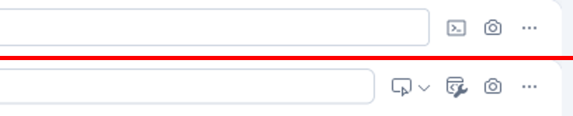
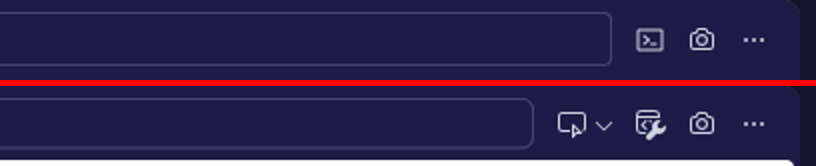

# Sprint 135: the screenshot baseline on VS Code 1.142 (R6, S13–S15)

The frame baseline is `docs/development/frame-baseline/`, approved by Jarmo at Sprint 134 on VS Code 1.117. Run on the 1.142 dev build: `scripts/qa/frame-screenshots.mjs` on a fresh profile with the sample project, 1440 × 900, Ritemark Light and Ritemark Dark. A scene "differs" when more than 0.5% of its pixels change.

## Result: 32 of 34 scenes match

The first run, before main was merged in and before the bar changed (below):

| Scenes | Pixels changed | Note |
|---|---|---|
| base, two-desks, left-hidden, ai-hidden, both-hidden, new-tab-menu, more-menu, terminal, switcher, tasks, browser, transcribe, agents (both themes) | 0% | |
| home (both themes) | 0.04% | Below the threshold; not looked into further. |
| settings-foot (both themes) | 0.02% | Below the threshold; not looked into further. |
| many-tabs | 0% light, 0.01% dark | Below the threshold. |
| **share-question** | **0.7% light, 0.94% dark** | See below. |

The re-run on the branch's head (main merged in, the bar as the Experience lead decided), on a fresh profile: still 32 of 34.

| Scenes | Pixels changed | Note |
|---|---|---|
| The thirteen above | 0% | |
| home (both themes) | 0.13% | Below the threshold: two "today" rows of Last changed in another order (the fresh sample copy's file times). |
| settings-foot (both themes) | 0.02% | Below the threshold. |
| many-tabs | 0.01% | Below the threshold. |
| **share-question** | **1.62% light, 1.88% dark** | The decided bar: one button fewer than 1.117's, so the address field is longer. Waits for Jarmo. |

## The share question: what differs and why

The browser bar, before (1.117, the baseline) above and after (1.142) below:

Full windows: [Light](share-question-light-1142.png), [Dark](share-question-dark-1142.png).

1. **"Add Element to Chat" and its "Add to Chat" menu are new on the bar.** They are VS Code's own chat features for the integrated browser (`browserEditorChatFeatures.ts`). They show only while VS Code's chat is on (`when: ChatContextKeys.enabled`), and the dev build turns it on with its built-in Copilot. The production build strips the built-in Copilot (`build-prod.sh` step 4.5), so a person sees them only after installing Copilot Chat. They send a page element to Copilot Chat, not to Ritemark's AI. **For the Experience lead (D5):** keep them for people who install Copilot Chat, or hide them in Ritemark (patch 010, beside the bar's other Ritemark changes).
2. **The Developer Tools button has a new icon** (a wrench where 1.117 had a terminal glyph). Upstream's icon; no setting brings the old one back. **For the Experience lead.**
3. **The address field is shorter** by the new button's width (follows from 1).
4. **The test page's own text** is drawn a little differently by Chromium 150 (Electron 43): edge pixels of the heading and paragraph. Nothing to pin.

**The Experience lead's decision (D5, 19 October):** (a) Add Element to Chat stays off Ritemark's bar even with Copilot Chat installed: it would sit beside Show Claude this page and send to Copilot Chat, not to the AI beside it. (b) Developer tools goes into the bar's ⋯ menu, as the drawings have it. Both are in patch 010. The 1.142 bar now reads back, forward, reload, the address, Show Claude this page, ⋯, with Developer tools (F12) in ⋯ ([the bar and its ⋯ menu](browser-bar-more-menu-1142.png)). The baseline's share-question scenes still differ (the bar has one button fewer than 1.117's); the baseline changes only with Jarmo's approval.

Pinned, so it no longer differs (S15): 1.142 added a "Share with Agent" toggle to the same bar. `workbench.browser.enableChatTools` is pinned off in `branding/product.json`.

## Defaults pinned back (S15, D5: engineering pins what a setting brings back)

All in `branding/product.json` `configurationDefaults`:

| Setting | Pinned | What 1.142 would show |
|---|---|---|
| `workbench.experimental.modernUI` | false | Floating cards, 4 px gaps, rounded parts, new tab and pane heights: every frame number changes |
| `workbench.welcomePage.experimentalOnboarding` | false | VS Code's Copilot sign-in wizard over a fresh profile's first window |
| `onboarding.enabled` | false | VS Code's feature tours and hints |
| `update.showPostInstallInfo` | false | VS Code's post-update notes |
| `workbench.browser.enableChatTools` | false | The browser bar's "Share with Agent" toggle |
| `workbench.commandPalette.showAskInChat` | false | All commands ends with "Ask in Chat: <what you typed>", opening VS Code's Chat view, whenever a chat agent is registered ([before](palette-1142-ask-in-chat.png), [1.117](palette-1117.png)) |

## Beyond the baseline: 1.142 and 1.117 side by side

The baseline covers the frame. For the surfaces inside it, the 1.142 dev build and the 1.117 build (the rollback rehearsal's tree) ran side by side, each on a fresh profile with the same project, and the same captures were diffed pixel by pixel.

| Surface | Light | Dark | Note |
|---|---|---|---|
| Markdown document, CSV, Word, PowerPoint, Excel, draw.io, a new flow | same | same | The only change is the AI sheet's model name ("Sonnet 5.5" against "Opus 5 with 1M context"): the 1.117 tree has no bundled runtimes, so its model catalog picks another default. |
| PDF | same after the fix | same after the fix | On 1.142 a PDF stayed on "Loading PDF…" ([before](pdf-loading-1142-before-fix.png), [1.117](pdf-1117.png), [after](pdf-1142-after-fix.png)). Fixed in this sprint (qa-evidence, found and fixed). |
| Command palette | differed | differed | "Ask in Chat: …" row; pinned off (above), then checked gone. |
| Quick Open, notification centre, Ritemark Settings | same | same | |
| High contrast, Light and Dark | same frame | same frame | The tree's open folders differed between the two runs; parts, rows and tabs keep their outlines ([Dark](high-contrast-dark-1142.png)). |

The welcome's own scenes (`scripts/qa/welcome-screenshots.mjs`, before main's #469 changed step 2): step 1 and step 2 in both themes match the baseline at 0%. The update welcome (a v1.14.0 profile, `update-off`) matches its baseline by eye: the same sheet, words, AI rows and switch; only the project rows differ, since they are this machine's recent folders. The start page was not reached: the profile copied for it had opened a folder on its first launch and never been through the welcome, so a window with no folder showed step 1, as Sprint 133's S38 says it should.
